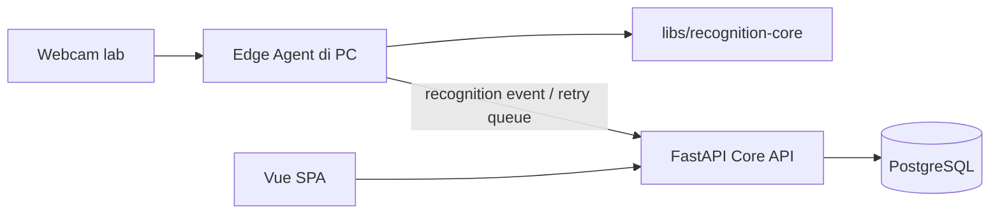
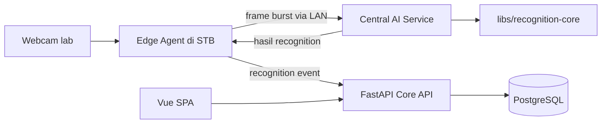
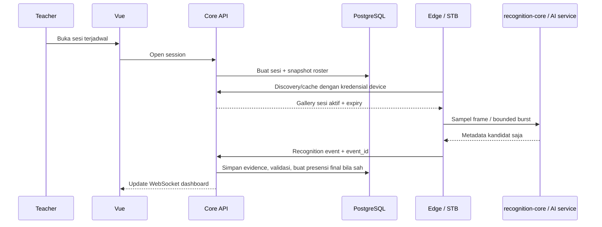

# Arsitektur Presensi Face Recognition

Pintu masuk sistem: presensi praktikum SMA. Satu Vue SPA, satu Core API FastAPI,
satu PostgreSQL, satu pipeline recognition (`libs/recognition-core`). Dua
deployment profile memakai core yang sama; bedanya hanya lokasi inference.

```text
kamera lab -> edge-agent/STB -> Core API + PostgreSQL -> dashboard guru
                (AI_EDGE: inference di PC lab | AI_CENTRAL: inference di server pusat)
```

`recognition_events` mencatat keluaran pengenalan (audit, selalu disimpan).
`attendance_records` hanya lahir setelah Core API memvalidasi sesi aktif,
snapshot roster, device, grace period, dan idempotency. Hasil AI ambigu tidak
pernah auto-accept: kembalikan `retry_frontal` / `NEED_FRONTAL_RETRY`.

Keputusan tim 2026-10-21: **`AI_EDGE` adalah profile default** (inference di PC
tiap lab). `STB_GATEWAY` + `AI_CENTRAL` didukung penuh dan opsional untuk lab
tanpa PC memadai. Pilihan akhir per lab wajib dibandingkan pada hardware nyata
(latency p50/p95, throughput, resource, biaya); angka asumsi bukan hasil
benchmark. Lihat [ADR-001](../adr/ADR-001-shared-recognition-core.md),
[ADR-002](../adr/ADR-002-session-opening-and-camera-preview-safety.md), dan
[ADR-003](../adr/ADR-003-per-teacher-opening-mode-and-manual-override.md).

## Matriks deployment

| Bentuk | Profile recognition | Di server | Di kamera |
| --- | --- | --- | --- |
| VPS + PC edge lab | AI_EDGE | PostgreSQL, Core API, Vue statis/reverse proxy | Native AI_EDGE edge-agent + YuNet/SFace per PC Ubuntu |
| Server pusat + STB | AI_CENTRAL | PostgreSQL, Core API, Vue, AI service pusat | Native STB_GATEWAY per STB ARM64; tanpa model identitas |
| Satu komputer | Biasanya AI_EDGE (AI_CENTRAL bisa diuji) | Compose lokal + web | Native edge-agent membuka webcam komputer yang sama |

Single-computer adalah topologi development/demo yang memakai salah satu
profile, bukan profile recognition ketiga. Untuk development, Docker menampung
PostgreSQL/Core API, Vite native untuk HMR, edge-agent/webcam native. Target
deployment PC edge dan semua server pusat: Ubuntu. Windows hanya untuk
development lokal dan demo supervised. Detail runbook: [deployment](../deployment.md).

## Profile A — AI_EDGE

Setiap lab menghubungkan kamera UVC ke PC edge. Agent menjalankan pipeline
`recognition-core` lokal, memakai gallery sesi aktif yang dicache, lalu mengirim
recognition event ke Core API dengan UUID idempotency (`event_id`) agar retry
jaringan aman. Saat API putus sementara, event antre di SQLite outbox; gallery
memory kedaluwarsa dan agent fail-closed sampai cache segar tiba.



## Profile B — STB camera gateway + AI_CENTRAL

STB ARM64 menjalankan agent ringan tanpa model recognition lokal: capture UVC
640×360 pada 10 FPS (batas runtime 1280×720/15 FPS), motion/quality gate,
cooldown, lalu burst maksimal 5 JPEG melalui LAN tepercaya ke AI service pusat.
AI service mengambil gallery sesi aktif dari Core API dengan kredensial
perangkat, menjalankan `recognition-core` yang sama, mengembalikan keputusan
terbatas ke gateway untuk dikirim sebagai event ke Core API. Frame transient,
tidak disimpan default. Gallery AI Central hanya di memory dengan expiry.



## Batas domain dan aliran data

- Matching dibatasi snapshot roster sesi aktif bila memungkinkan; threshold
  dikalibrasi dari data uji lokal (tanpa default internet).
- Sebelum/sesudah sesi pada AI_EDGE, preview boleh memakai gallery sementara
  yang dibatasi siswa bertemplate di kelas dengan jadwal valid hari itu di lab
  tersebut. Gallery ini hanya di memory, masa cache dibatasi, tidak pernah
  membuat event/record. Saat sesi aktif, agent wajib kembali ke snapshot roster.
- Recognition memakai bukti multi-frame dan margin Top-1/Top-2. Ambigu → retry
  frontal, bukan presensi final.
- Frame mentah diproses sementara, tidak disimpan default. Embedding template
  disimpan sebagai ciphertext AES-256-GCM. Log dan respons operator bebas
  gambar, embedding, token, password, dan secret.
- Template wajah menyimpan nama dan versi model. Pilihan model butuh tinjauan
  lisensi dan validasi lokal. Data siswa nyata/minor tidak dipakai di
  cloud/CI dan tidak masuk repository.

## Preview kamera pra-sesi (15 menit)

Preview lokal operator terautentikasi (ADMIN/LABORANT) menampilkan kotak wajah
dari pemeriksa kualitas kamera dan kandidat nama/kelas. Bila tidak ada sesi
aktif, gallery hanya mencakup kelas yang dijadwalkan di lab itu hari tersebut,
dalam jendela mulai **15 menit sebelum jadwal sampai akhir jadwal**. Nama
ditandai kandidat; cosine adalah skor kecocokan, bukan probabilitas. Jalur
preview tidak pernah membuat recognition event atau attendance record. Saat
sesi aktif, hanya snapshot roster sesi yang dipakai.

## Peta repository

| Path | Isi |
| --- | --- |
| `apps/web` | Vue UI; type client dari OpenAPI |
| `apps/api` | HTTP schema/router, permission, service SQLAlchemy, config migrasi |
| `apps/edge-agent` | Capture UVC native, runtime AI_EDGE dan STB_GATEWAY |
| `apps/ai-service` | Inference frame terpusat |
| `libs/recognition-core` | Protokol domain, pipeline, temporal decision |
| `infra/deployment` | Compose production dan bootstrap DB |
| `infra/docker` | Image service |
| `scripts` | Task runner dev/check/regression; `start-local.py` entry point |
| `docs/architecture` | Kontrak sistem dan keputusan fitur |
| `tests` | Harness regresi sintetis, AI/deployment benchmark |

## Mulai lokal

```powershell
# Windows
py -3 scripts/start-local.py
# Ubuntu
python3 scripts/start-local.py
```

Perintah ini membuat `.env` lokal, menjalankan PostgreSQL/Core API, migrasi
Alembic + seed role, bootstrap admin, memasang dependency web, dan menjalankan
Vite (`http://127.0.0.1:5173`, API `http://127.0.0.1:8000`). Login awal:
`admin@local.test` / `1234abcd` (override via `PRESENSI_BOOTSTRAP_PASSWORD`),
wajib ganti password (min 12 karakter) saat login pertama. Tiga penyebab login
gagal paling sering: password lama yang salah, bootstrap tidak me-reset akun
yang sudah ada, dan token awal yang dibatasi endpoint ganti password.

## Alur enrollment dan session-to-attendance



Enrollment: operator ADMIN/LABORANT memilih kelas + siswa, capture 4 frame
setelah countdown 3 detik, API memproses YuNet/SFace, menolak frame
buruk/multi-wajah, menyimpan 3–5 embedding terbaik terenkripsi AES-256-GCM.
Raw capture dibuang. Revokasi menghapus SEMUA template aktif siswa sekaligus.

## Baseline UI

`apps/web` satu-satunya frontend: Vue 3 + Vite + TypeScript. Baseline visual
Gentelella v4.1.1 dipakai sebagai design token (SCSS, layout, ikon, pola
komponen); perilaku UI dibangun sebagai komponen Vue — jangan menjalankan
script vanilla template yang memutasi DOM milik Vue. Router memakai dua branch
layout: `/auth` (login) dan `/app` (area terautentikasi). Tema tersimpan
sebagai `presensi.theme` di local storage, fallback ke preferensi OS. Menu
sidebar hanya memuat rute yang sudah diimplementasikan; atribusi dan lisensi
MIT Gentelella dipertahankan (lihat `docs/licenses/`).

## Status implementasi

| Area | Status |
| --- | --- |
| Master data, roster, jadwal, sesi, import, device registry, report | Tersedia; lihat sisa tugas di backlog |
| Enrollment, template terenkripsi, revoke/re-enroll | Tersedia |
| AI_EDGE dan AI_CENTRAL via recognition-core + otoritas Core API | Tersedia; kalibrasi threshold menyusul |
| Presensi manual guru, opening_mode per guru, manual_override | Tersedia |
| Kalibrasi threshold lokal, field test, deployment-benchmark | Belum — `MANUAL HARDWARE TEST REQUIRED` |

Tabel sisa tugas dan riwayat: [backlog](../backlog.md). Detail tiap subsistem:
[fondasi backend](fondasi-backend.md), [siklus presensi](siklus-presensi.md),
[AI inferensi](ai-inferensi.md), [perangkat dan konfigurasi](perangkat-dan-konfigurasi.md).
