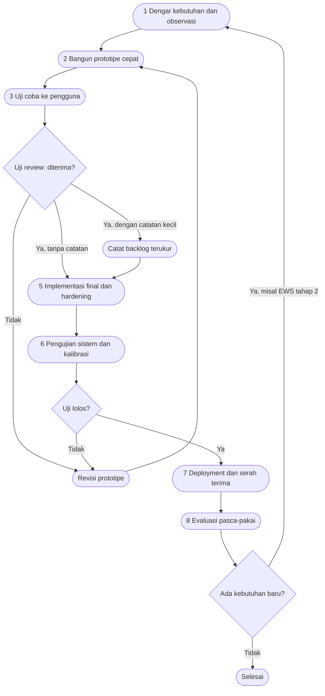

# 02 — Metode Pengembangan: Prototype (bahan Bab III)

> Metode ini menggantikan waterfall dan menggantikan iterative-incremental
> ala sprint. Alasannya: threshold AI, perilaku kamera lab, dan kebutuhan UI
> guru/laboran tidak bisa ditetapkan di awal — harus ditemukan lewat
> mockup → uji coba → review → revisi yang berulang.

## 2.1 Tahapan (dengan siklus review dan uji-coba kembali)

Keterangan siklus (yang membedakannya dari waterfall):

- Panah `P4 -- Tidak --> P7 --> P2` = **review** menolak → kembali ke mockup,
  bukan lanjut ke tahap berikut.
- Panah `P8 --> P9 -- Tidak --> P7` = **uji coba kembali (re-test)**:
  pengujian gagal → revisi → uji ulang, bukan sekali jalan.
- Panah `P11 --> P12 -- Ya --> P1` = kebutuhan baru (contoh: EWS tahap 2)
  memutar siklus baru tanpa merombak arsitektur yang sudah diterima.

## 2.2 Mengapa bukan waterfall / bukan incremental

| Aspek | Waterfall (ditolak) | Incremental sprint (ditolak) | Prototype (dipakai) |
|---|---|---|---|
| Asumsi awal | Kebutuhan + threshold diketahui di awal | Rilis bertambah tiap sprint | Kebutuhan ditemukan lewat mockup |
| Cocok untuk AI kalibrasi? | Tidak — threshold wajib uji hardware | Sebagian — tapi rilis parsial berisiko dipakai final | Ya — prototipe boleh salah, yang final terkalibrasi |
| Peran review | Akhir (acceptance) | Review sprint | **Setiap putaran** (P4) + re-test (P9) |
| Bukti di proyek ini | — | — | CameraPreview loopback, panel at-risk, harness kalibrasi |

## 2.3 Pemetaan tahap → bukti di proyek

| Tahap | Bukti konkret |
|---|---|
| 1. Observasi | Lab kimia 2 ruang paralel; jadwal Jumat; budaya semi-militer |
| 2. Prototipe cepat | Dashboard Gentelella, CameraPreview loopback tanpa event, panel "Siswa perlu perhatian" |
| 3. Uji coba pengguna | Guru buka sesi manual/override; laboran enrollment + preview |
| 4. Review | Backlog P1-1…P2-2; ADR-001…ADR-003 sebagai catatan keputusan |
| 5–6. Final + pengujian | `scripts/check.py` (ruff, format, mypy, pytest, eslint, prettier, vue-tsc, vitest); 17 migrasi Alembic; 21 pytest + 8 vitest untuk EWS |
| 7–8. Deployment + evaluasi | Profil AI_EDGE default vs AI_CENTRAL; evaluasi melahirkan EWS tahap 2 |

## 2.4 Pintu kalibrasi (wajib sebelum klaim angka)

Threshold identitas (`min_top1_similarity`, `min_top1_top2_margin`) dan ambang
EWS **tidak boleh** memakai angka dari internet sebagai nilai final.
Pintu yang harus dilewati: harness `tests/ai-benchmark` + protokol
`docs/pengujian.md` + deployment-benchmark di hardware target (minimal 5
lintasan/relawan per profil). Selama belum dilewati, semua angka performa
bertanda `MANUAL HARDWARE TEST REQUIRED`.
