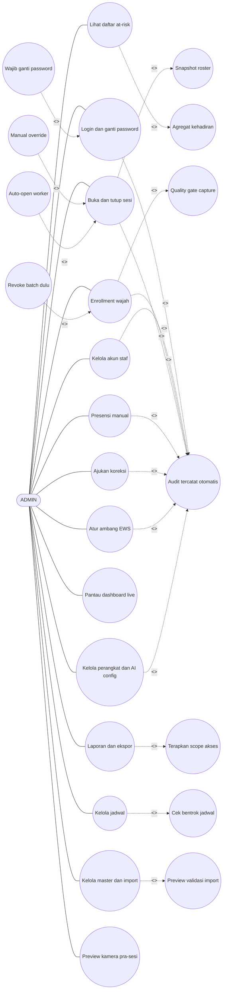
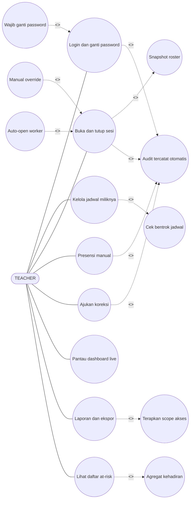
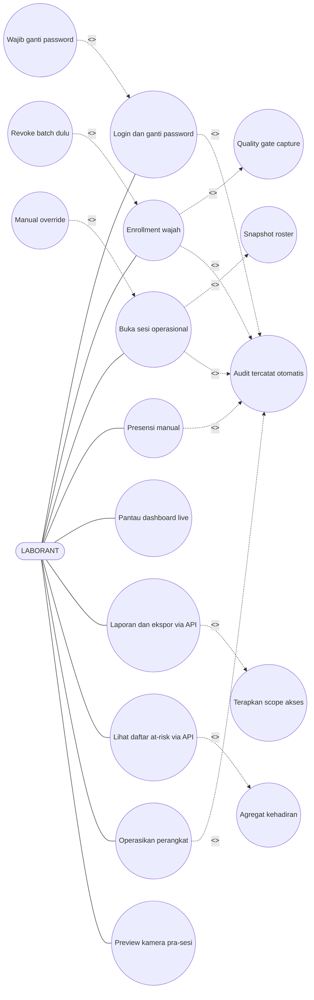
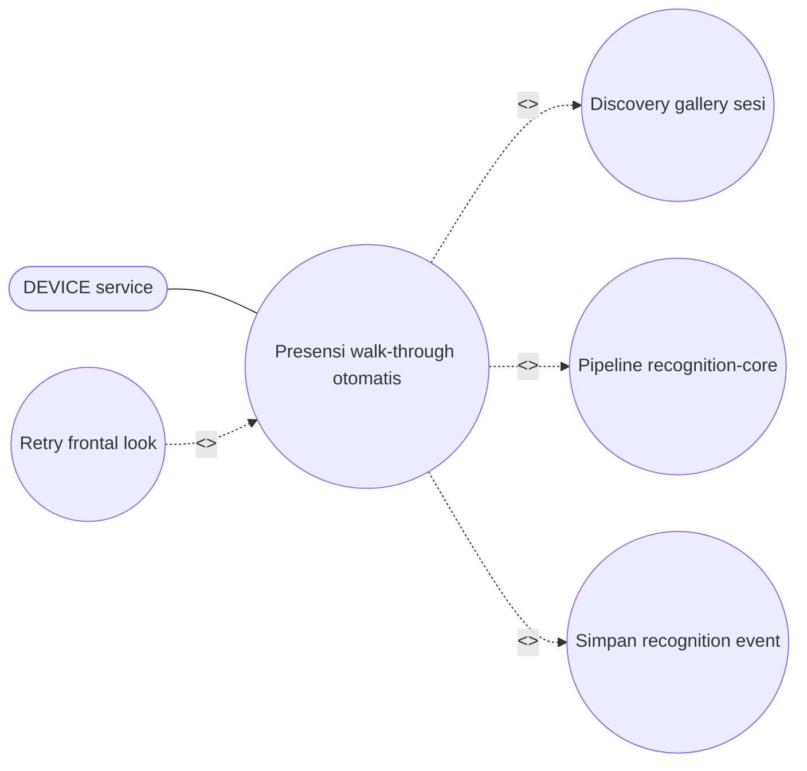
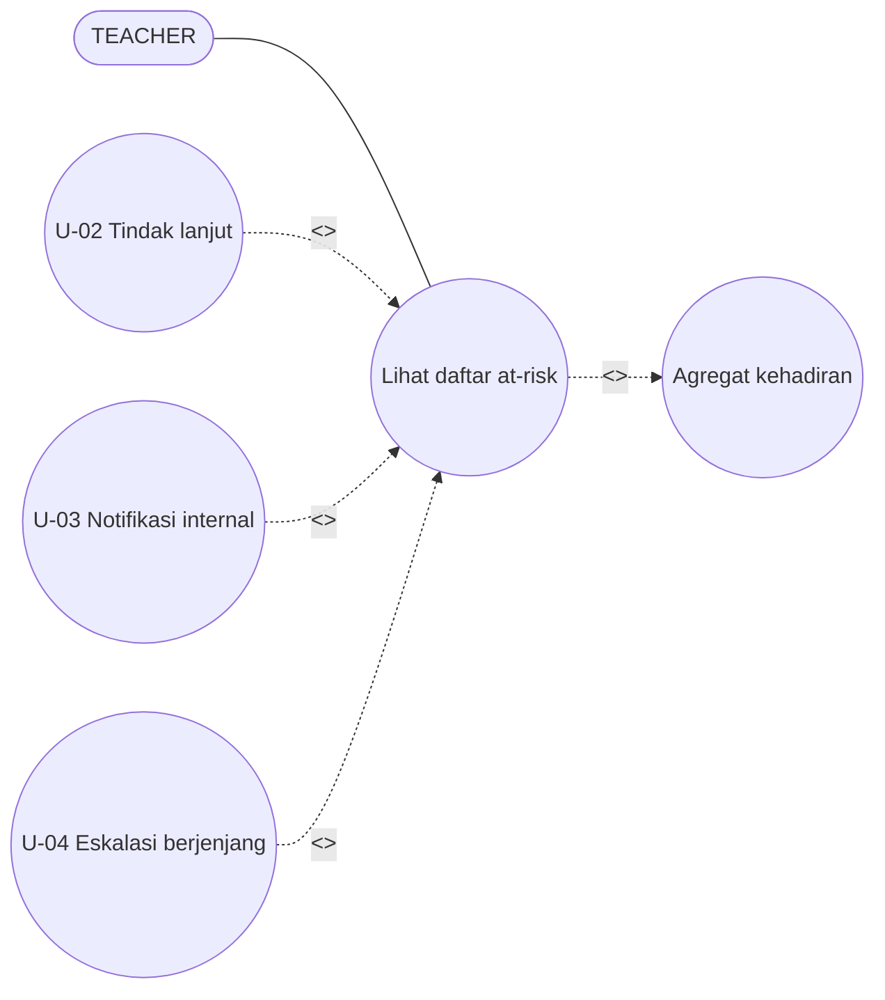

# 04 — Use Case Diagram

> Mermaid tidak punya tipe `usecaseDiagram`, jadi diagram di bawah memakai
> `flowchart`: aktor = `[...]`, use case = `((...))`, asosiasi aktor-use case =
> garis solid tanpa arah (`---`), `<<include>>`/`<<extend>>` = satu edge
> titik-titik berlabel stereotype (`-. <<include>> .->` / `-. <<extend>> .->`).
> Arah include: base -> included (contoh `UC6 -. <<include>> .-> UC16`).
> Arah extend: extension -> base (contoh `MO -. <<extend>> .-> UC6`).
> Semua sintaks di bawah valid untuk Mermaid v10+.

## 4.1 Diagram keseluruhan sistem

```mermaid
flowchart LR
  ADM([ADMIN])
  TCH([TEACHER])
  LAB([LABORANT])
  DEV([DEVICE service])
  subgraph SYS[Sistem Presensi]
    UC1((Login dan ganti password))
    UC2((Kelola master dan import))
    UC3((Kelola akun staf))
    UC4((Enrollment wajah))
    UC5((Kelola jadwal))
    UC6((Buka dan tutup sesi))
    UC7((Presensi walk-through otomatis))
    UC8((Presensi manual))
    UC9((Ajukan koreksi))
    UC10((Pantau dashboard live))
    UC11((Laporan dan ekspor))
    UC12((Lihat daftar at-risk))
    UC13((Atur ambang EWS))
    UC14((Kelola perangkat dan AI config))
    UC15((Preview kamera pra-sesi))
    UC16((Audit tercatat otomatis))
    PREV((Preview validasi import))
    QG((Quality gate capture))
    RB((Revoke batch dulu))
    CB((Cek bentrok jadwal))
    SR((Snapshot roster))
    MO((Manual override))
    AO((Auto-open worker))
    DG((Discovery gallery sesi))
    PI((Pipeline recognition-core))
    SE((Simpan recognition event))
    RF((Retry frontal look))
    WP((Wajib ganti password))
    AG((Agregat kehadiran))
    U2((U-02 Tindak lanjut))
    U3((U-03 Notifikasi internal))
    U4((U-04 Eskalasi berjenjang))
    SC((Terapkan scope akses))
  end
  ADM --- UC1 & UC2 & UC3 & UC4 & UC5 & UC6 & UC8 & UC9 & UC10 & UC11 & UC12 & UC13 & UC14 & UC15
  TCH --- UC1 & UC5 & UC6 & UC8 & UC9 & UC10 & UC11 & UC12
  LAB --- UC1 & UC4 & UC6 & UC8 & UC10 & UC11 & UC12 & UC14 & UC15
  DEV --- UC7
  UC1 -. <<include>> .-> UC16
  WP -. <<extend>> .-> UC1
  UC2 -. <<include>> .-> PREV
  UC3 -. <<include>> .-> UC16
  UC4 -. <<include>> .-> QG
  UC4 -. <<include>> .-> UC16
  RB -. <<extend>> .-> UC4
  UC5 -. <<include>> .-> CB
  UC6 -. <<include>> .-> SR
  UC6 -. <<include>> .-> UC16
  MO -. <<extend>> .-> UC6
  AO -. <<extend>> .-> UC6
  UC7 -. <<include>> .-> DG
  UC7 -. <<include>> .-> PI
  UC7 -. <<include>> .-> SE
  RF -. <<extend>> .-> UC7
  UC8 -. <<include>> .-> UC16
  UC9 -. <<include>> .-> UC16
  UC11 -. <<include>> .-> SC
  UC12 -. <<include>> .-> AG
  U2 -. <<extend>> .-> UC12
  U3 -. <<extend>> .-> UC12
  U4 -. <<extend>> .-> UC12
  UC13 -. <<include>> .-> UC16
  UC14 -. <<include>> .-> UC16
```

> UC7 hanya milik DEVICE. UC16 milik sistem otomatis: tanpa asosiasi aktor
> manusia, write-only. U-02/U-03/U-04 hanya usulan Tahap 2 (extend), bukan
> perilaku jalan. LABORANT memakai UC11/UC12 via API tanpa menu UI.

## 4.2 UC ADMIN

## 4.3 UC TEACHER (guru)

> TEACHER tidak punya UC4, UC14, maupun UC15. UC8/UC9 TEACHER dibatasi
> jadwal miliknya; di luar scope → 404.

## 4.4 UC LABORANT

> LABORANT memakai UC11/UC12 via API tanpa menu UI (menu Laporan hanya
> untuk ADMIN/TEACHER). LABORANT tidak punya UC2, UC3, UC5, UC9, UC13.

## 4.5 UC DEVICE + inti recognition

> UC7 eksklusif milik DEVICE (kredensial perangkat). Tidak ada aktor manusia
> berasosiasi ke UC7. Event recognition selalu disimpan; record presensi
> hanya lahir bila seluruh validasi lolos.

## 4.6 UC EWS (tahap 1 jalan + tahap 2 usulan)

> U-02/U-03/U-04 hanya extend usulan Tahap 2; perilaku jalan Tahap 1
> (UC12 + agregat) tidak berubah. Diagram ini memakai TEACHER sebagai aktor
> fungsional guru/BK untuk tahap berjalan; eskalasi ke wali kelas/BK adalah
> bagian usulan U-04. Akses UC12 mengikuti scope 4.1:
> ADMIN semua, TEACHER miliknya/kelasnya, LABORANT via API tanpa menu UI.

## 4.7 Spesifikasi per use case

| UC | Aktor | Prasyarat | Alur utama → hasil | Alternatif / relasi |
|---|---|---|---|---|
| UC1 | Semua human (ADMIN/TEACHER/LABORANT) | Akun aktif | Kredensial → token (akses 15 mnt, sesi 24 jam); password baru min 12 char; password awal wajib diganti; login/ganti password beraudit | Salah → pesan umum; `must_change` → extend wajib ganti; UC1 include UC16 |
| UC2 | ADMIN | File CSV/XLSX | Preview validasi → commit → master tersimpan (file ≤5 MiB, XLSX ≤25 MiB uncompressed, ≤10.000 baris) | Baris invalid → 422 per baris; UC2 include preview; commit import tidak menulis audit |
| UC3 | ADMIN | — | Email+role unik → akun aktif + password sementara sekali pakai yang wajib diganti; operasi akun beraudit | Email ganda → 409; UC3 include UC16 |
| UC4 | ADMIN/LABORANT | Siswa aktif | 3–10 capture → min 3 lolos → maks 5 template AES-256-GCM + model name/version | 0/multi/buram ditolak; mirip siswa lain → warning 0,85; sudah enrolled → 409, extend revoke; UC4 include quality gate dan UC16 |
| UC5 | ADMIN/TEACHER | Kelas+lab+guru aktif | Jadwal mingguan tersimpan | Bentrok → 409 `schedule_conflict`; UC5 include cek bentrok; tulis jadwal tidak menulis audit |
| UC6 | ADMIN semua; TEACHER miliknya; LABORANT operasional | Jadwal eligible hari ini | Sesi + snapshot roster; auto-close worker akhir jadwal → `closed` beraudit; auto-open worker melewati roster kosong tanpa membuat sesi | Di luar jendela → extend manual_override; guru automatic → extend auto-open worker; UC6 include snapshot roster dan UC16; publikasi policy pembukaan sesi oleh ADMIN (`MANAGE_SETTINGS`) beraudit |
| UC7 | DEVICE | Sesi aktif + gallery | Frame/burst → decision → event → record bila 5 syarat lolos | Ambigu → extend retry_frontal; invalid → event saja; replay idempoten via event UUID; UC7 include discovery gallery, pipeline inti, simpan event |
| UC8 | Pemegang `SESSION_OPERATE` (ADMIN semua; TEACHER/LABORANT sesuai scope) | Sesi berjalan + di roster + belum ada record | Record manual + audit | Menimpa record FR → ditolak; TEACHER di luar scope → 404; UC8 include UC16 |
| UC9 | ADMIN/TEACHER | Record ada + alasan wajib | Koreksi **pending** beraudit (belum ada endpoint putusan) | Tanpa alasan → 422; UC9 include UC16 |
| UC10 | Semua login | Sesi ada | Snapshot + WS per 2 dtk | Token mati → 4401; tanpa hak `SESSION_OPERATE` → 4403; sesi tak ada → 4404 |
| UC11 | ADMIN semua; TEACHER miliknya; LABORANT via API tanpa menu UI | — | Tabel agregat + baris + ekspor ≤50.000 | Guru difilter miliknya (include scope); tanpa record: open→not_recorded, closed→absent |
| UC12 | ADMIN semua; TEACHER miliknya/kelasnya; LABORANT via API tanpa menu UI | Policy ada | Daftar flag + reasons + ambang efektif + revisi policy | Sesi open tak dihitung absen; `excused` ≠ absen |
| UC13 | ADMIN (publikasi); baca: pemegang `SESSION_OPERATE` | — | Ambang + revisi tersimpan beraudit | Di luar rentang → 422; UC13 include UC16 |
| UC14 | ADMIN penuh; LABORANT operasi/status | Device terdaftar di lab | Provision/rotate/renew bearer beraudit; heartbeat; pause kamera beraudit (ADMIN, `MANAGE_SETTINGS`) | Sync token tak cocok → 401; AI service tanpa device_tokens → 503 `auth_misconfigured`; device nonaktif → 409; UC14 include UC16 |
| UC15 | ADMIN/LABORANT | ≤15 mnt sebelum mulai | Loopback 127.0.0.1:8765: overlay wajah + nama kandidat, tanpa event/audit | Di luar jendela → ditolak; bila sesi aktif → 409 dan gunakan roster snapshot sesi berjalan |
| UC16 | Sistem (otomatis), tanpa asosiasi aktor manusia | Aksi perubahan terjadi | Tulis `audit_logs`; write-only, dibaca via DB (tanpa endpoint/UI) | Di-include UC1/UC3/UC4/UC6/UC8/UC9/UC13/UC14 |

> Peta audit lengkap: login/ganti password (`auth.*`), akun (`account.created`),
> enrollment/revoke (`face_template.*`), buka/tutup sesi (`attendance_session.*`,
> termasuk worker otomatis), manual (`attendance.manual_marked`), koreksi
> (`attendance.correction.requested`), publikasi policy
> (`runtime_configuration.published`), kredensial/registry/kamera device
> (`device.*`). Jadwal (UC5) dan commit import (UC2) tidak menulis audit.
