# 05 — Activity Diagram

> Satu diagram per fitur. Judul gambar laporan: "Activity Diagram \<kode fitur>".
> Ringkasan per role ada di §5.13–§5.14.

## 5.1 Login (F-01)

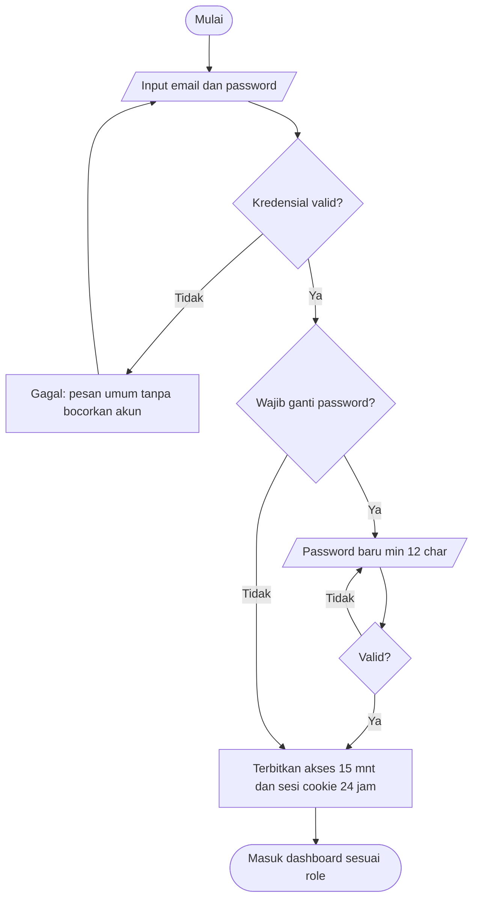

## 5.2 Master data + import (F-02)

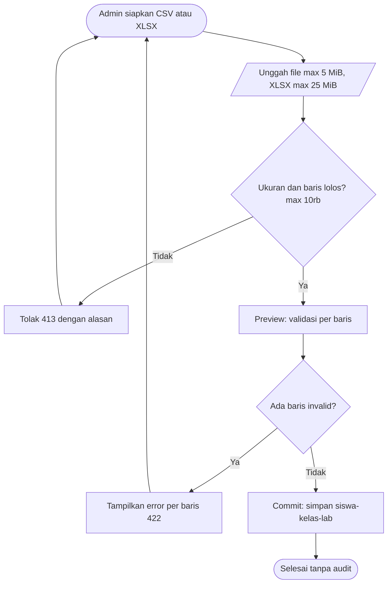

> Commit import tidak menulis `audit_logs`; validasi dan commit hanya
> mengembalikan ringkasan baris valid atau invalid.

## 5.3 Enrollment wajah (F-03)

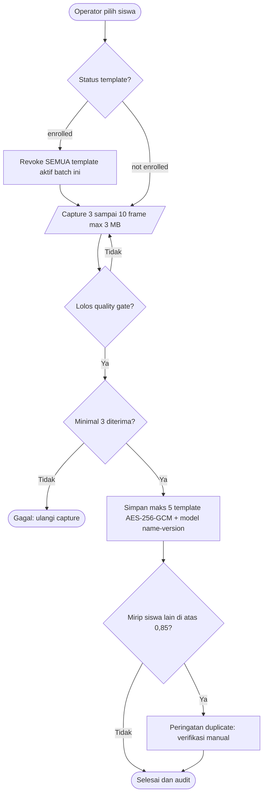

> `POST /enrollments` metadata-only (tanpa capture) ditolak 422
> `captures_required`; gunakan `POST /enrollments/captures`. Revoke
> template per batch mencatat jumlah + audit; siswa dinonaktifkan ikut
> me-revoke template aktifnya.

## 5.4 Jadwal praktikum (F-04)

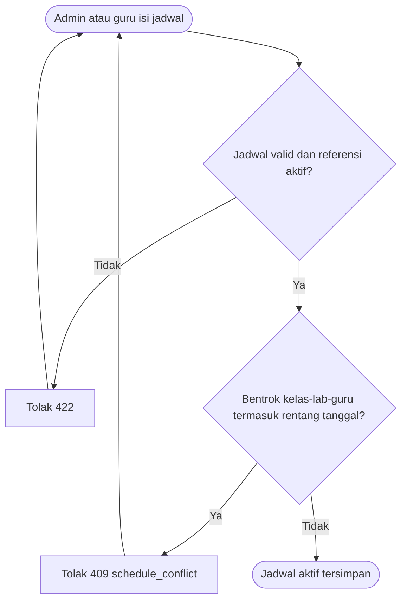

> Operasi jadwal (CRUD) tidak menulis `audit_logs`.

## 5.5 Buka dan tutup sesi (F-05)

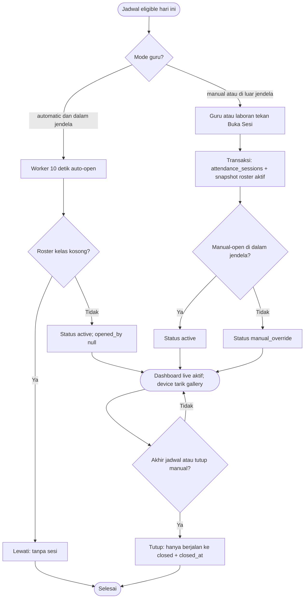

> Guru hanya membuka jadwal miliknya (di luar itu 404 `schedule_not_found`);
> manual-open selalu tersedia sebagai jalur override dan tidak digate `mode`
> policy. Auto-open worker langsung
> berstatus `active` dengan `opened_by` null; hanya jalur manual yang dinilai
> masuk/di luar jendela (`active` vs `manual_override`). Auto-open melewati
> roster kosong (tidak membuat sesi). Tutup hanya bertransisi dari status
> berjalan (`active`, `manual_override`) ke `closed`; sesi yang sudah
> `closed` atau `cancelled` dikembalikan apa adanya tanpa perubahan.

## 5.6 Walk-through otomatis (F-06) — inti penelitian

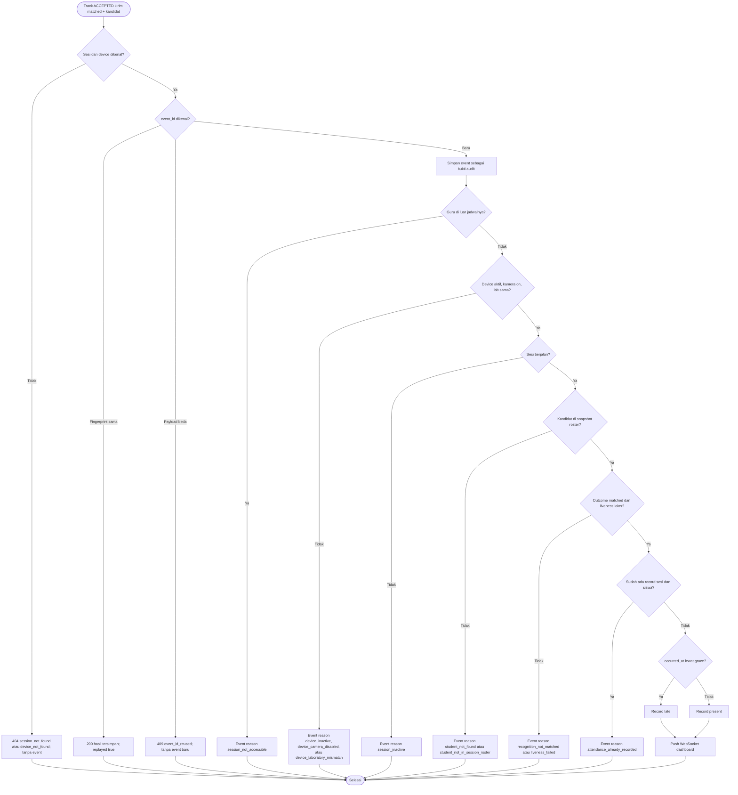

Status track temporal (`collecting` / `accepted` / `retry_frontal` alias
NEED_FRONTAL_RETRY / `rejected`) bukan outcome event (`matched` /
`ambiguous` / `no_match` / `error` / `redacted`). Aturan mesin:
N frame sepakat (`minimum_agreeing_frames`, terkalibrasi) + Top-1 di atas
threshold + margin Top-1 dan Top-2; galeri satu identitas tidak pernah
accept (`single_identity_gallery`, fail-closed ke retry); margin terlalu
kecil menjadi `ambiguous` + `retry_frontal`; Top-1 di bawah threshold
menjadi `rejected` (`no_match`); bila liveness required, spoof yang lolos
menjadi `rejected` dan inconclusive menjadi retry; liveness opsional yang
inconclusive tidak menghentikan embed/match.

Aturan event dan grace: sesi atau device tak dikenal → 404 tanpa event.
Ingest juga menutup sesi kedaluwarsa sebelum validasi. Jalur device bearer
melewati cek scope guru (perangkat terikat lab/sesi); cek
`session_not_accessible` hanya untuk ingest manusia oleh TEACHER non-ADMIN
di luar jadwalnya.
Event baru disimpan dulu sebagai bukti audit sebelum putusan (matched
tanpa kandidat valid disimpan sebagai `error` agar audit tetap utuh).
Replay memakai fingerprint kanonis: sama → hasil tersimpan
(`replayed: true`); `event_id` sama dengan payload berbeda → 409
`event_id_reused` tanpa event baru. Sepuluh reason resmi, dievaluasi
berurutan: `session_not_accessible`, `device_inactive`,
`device_camera_disabled`, `device_laboratory_mismatch`,
`session_inactive`, `student_not_found`,
`student_not_in_session_roster`, `recognition_not_matched`,
`liveness_failed`, `attendance_already_recorded`. Grace memakai capture time (`occurred_at`):
sesi auto-open → `scheduled_start_at + grace`; sesi manual-open →
`opened_at + grace`; tepat atau di batas = present. Duplikat konkuren
ditahan UNIQUE sesi dan siswa lewat savepoint: event audit tetap
tersimpan, reason `attendance_already_recorded`.

## 5.7 Presensi manual + koreksi (F-07)

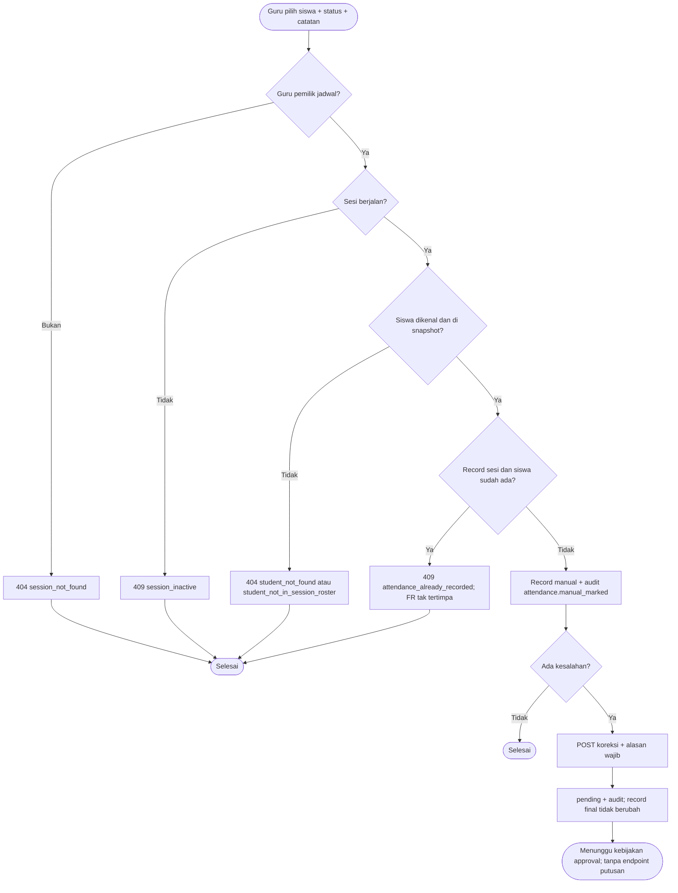

> Manual diizinkan pada sesi berjalan (`active` maupun `manual_override`),
> di dalam maupun di luar jendela auto-open. Guru di luar jadwalnya
> fail-closed 404 `session_not_found` (bukan 403). Record manual bersource
> `manual` dengan `recognition_event_id` null dan audit
> `attendance.manual_marked` berisi snapshot roster + catatan; varian
> `system` juga tanpa event. Record FR tidak boleh ditimpa manual (dan
> sebaliknya): duplikat sesi dan siswa, termasuk balapan konkuren lewat
> savepoint, selalu 409 `attendance_already_recorded`.
> Koreksi HANYA menghasilkan `pending` (+ audit
> `attendance.correction.requested`). Tidak ada keputusan approve atau
> reject di sistem berjalan — alur "Admin setujui" TIDAK BOLEH digambar
> sebagai fitur jalan.

## 5.8 Live dashboard (F-08)

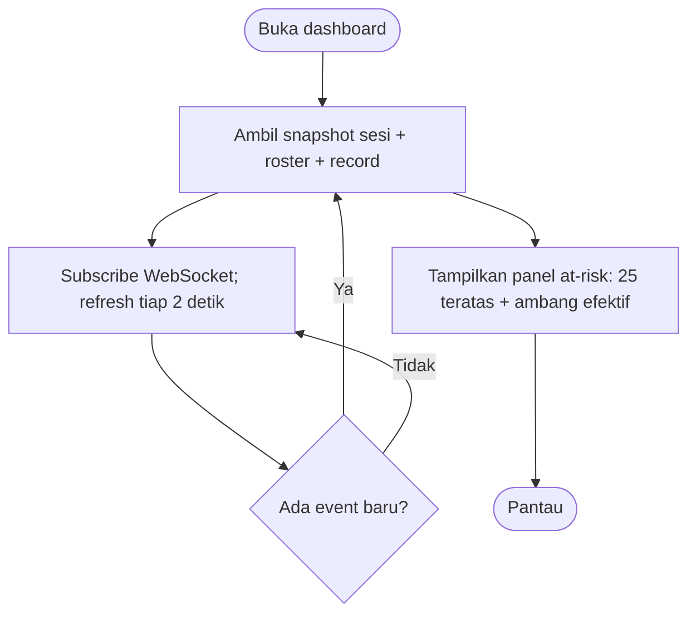

## 5.9 Laporan dan ekspor (F-09)

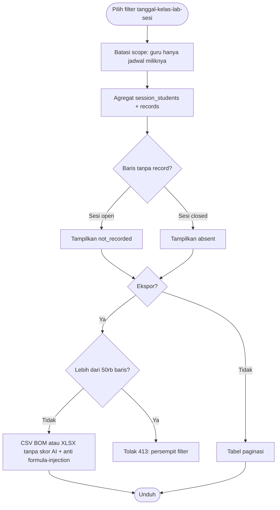

## 5.10 EWS at-risk tahap 1 (F-10)

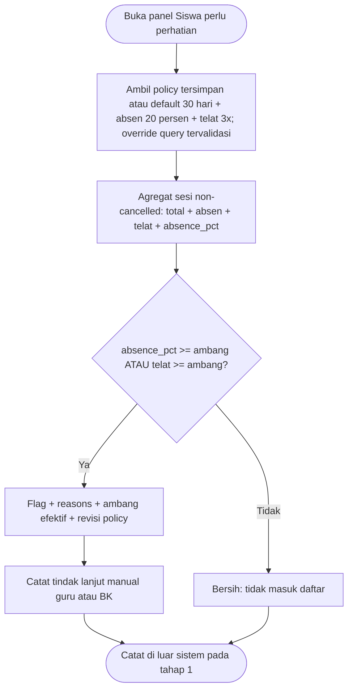

Aturan agregat: sesi `cancelled` dikecualikan; sesi closed tanpa record = absen;
sesi open tanpa record = `not_recorded` (tidak dihitung absen);
`excused` bukan absen. Urut: absence_pct desc, late desc, nama.

## 5.11 Perangkat (F-11)

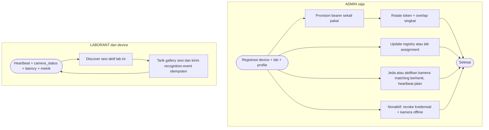

> Registrasi, update assignment, nonaktif, provision, dan rotate kredensial
> wajib `MANAGE_MASTER_DATA` (ADMIN); jeda atau aktif kamera wajib
> `MANAGE_SETTINGS` (ADMIN); heartbeat operator dan list device memakai
> `DEVICE_OPERATE` (LABORANT, ADMIN); renew memakai kredensial device
> itu sendiri. Guru tidak punya operasi device. Heartbeat device nonaktif
> → 409 `device_inactive`; profile heartbeat tak cocok → 409
> `deployment_profile_mismatch`; gallery saat kamera dijeda → 409
> `device_camera_disabled`.

## 5.12 AI config + preview (F-12)

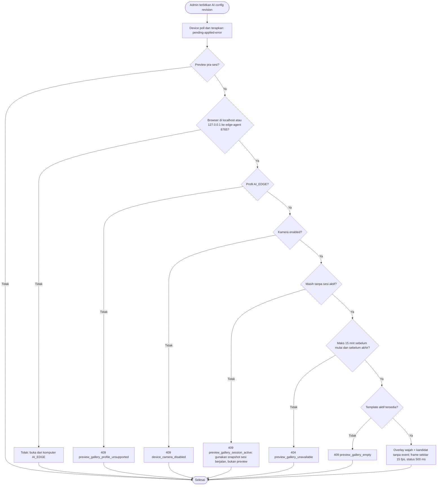

> Preview hanya AI_EDGE dari browser loopback (`localhost` atau
> `127.0.0.1`) ke edge-agent port 8765, tanpa sesi aktif, di jendela
> mulai-minus-15-menit sampai akhir jadwal lab hari itu. Kandidat
> diagnostik boleh tampil (nama + persen kemiripan model, bukan akurasi)
> tetapi tanpa event dan tanpa record; presensi hanya lahir dari Core API
> saat sesi aktif dan kebijakan pengenalan lolos. Tanpa threshold
> kalibrasi lokal → `waiting_for_calibration`, presensi tidak dibuat.
> Frame preview transient di memori browser dan tidak disimpan.

## 5.13 Akun + audit (F-13/F-14)

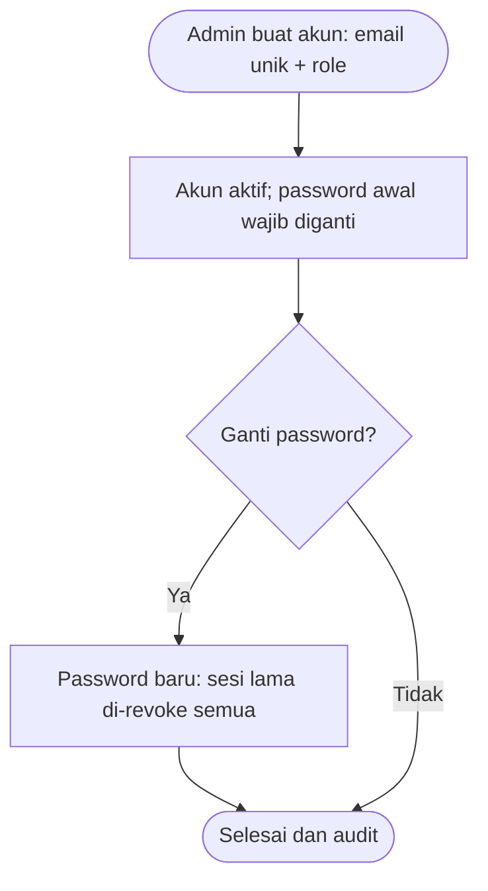

> Ganti password berlaku untuk semua pengguna login; password sementara akun
> baru wajib diganti sebelum dipakai, dan sesi lama ikut di-revoke.

## 5.14 Ringkasan alur per role (untuk sub-bab "Akses per role")

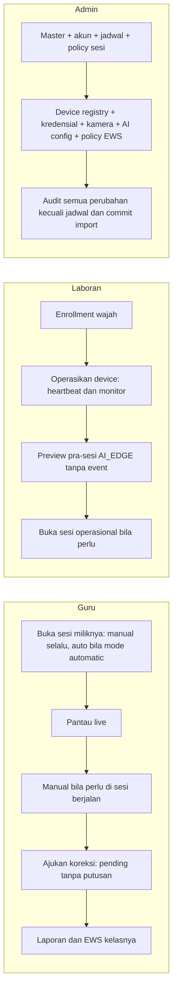

> Guru: tanpa operasi device dan enrollment; koreksi miliknya hanya
> `pending`. Laboran: tanpa registrasi atau deaktivasi device, tanpa
> rotate kredensial, tanpa camera-control, tanpa koreksi. Admin: satu-satunya
> pemegang `MANAGE_MASTER_DATA` dan `MANAGE_SETTINGS`.
