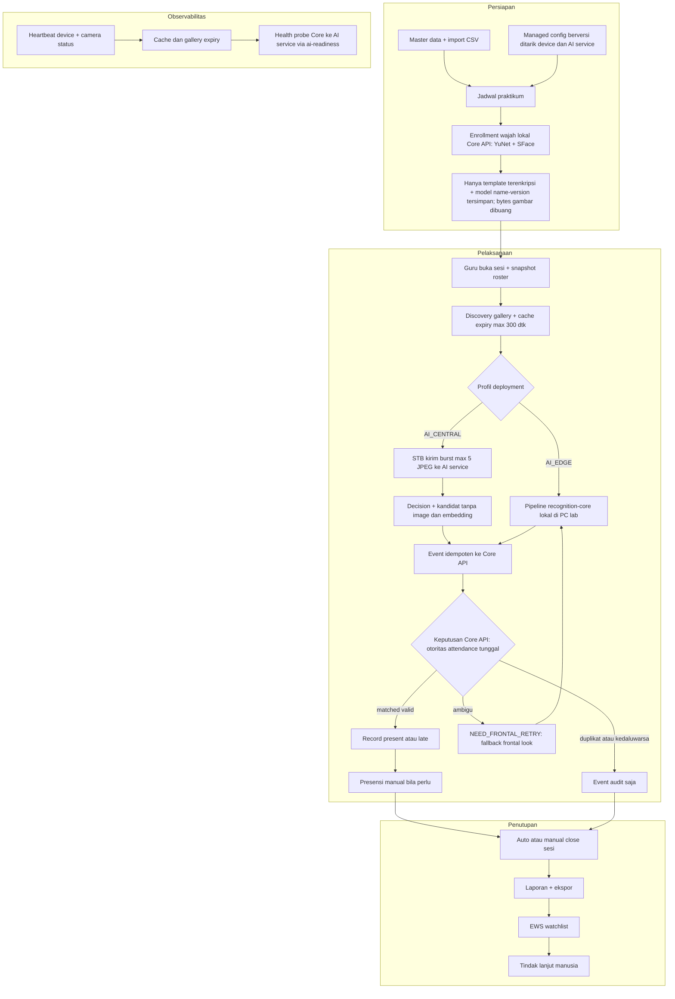
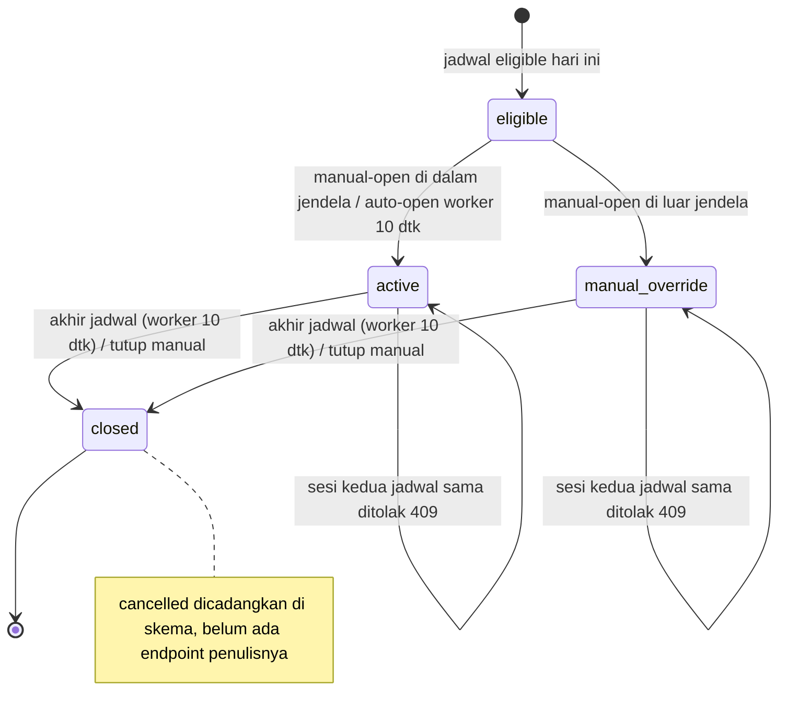
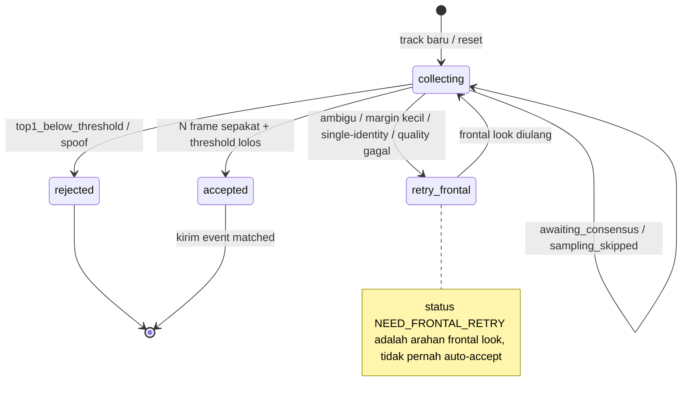

# 06 — Proses Bisnis dan Alur Keseluruhan

Konsisten dengan [03](03-fitur-dan-peran.md) (F-03, F-05, F-06, F-12),
[04](04-use-case.md) (UC4, UC6, UC7), [05](05-activity.md) (§5.3, §5.5, §5.6),
dan [08](08-arsitektur.md) (satu core, pipeline, keamanan data wajah).
Otoritas attendance tunggal selalu Core API untuk AI_EDGE maupun AI_CENTRAL:
AI service dan edge agent tidak pernah menulis `attendance_records`.

## 6.1 Alur end-to-end (render → "Diagram Alir Keseluruhan")



Narasi: guru membuka sesi (UC6, §5.5) → device/STB discovery gallery sesi
aktif dan menarik snapshot roster + template sesuai model name-version →
walk-through recognition cepat di jalur utama, frontal look sebagai fallback
(§5.6) → event idempoten ke Core API → Core API satu-satunya yang boleh
menerbitkan `attendance_records` → dashboard live, laporan, lalu EWS watchlist
dengan tindak lanjut manusia.

## 6.2 Sequence sesi → presensi (render → "Sequence Diagram")

```mermaid
sequenceDiagram
  participant Guru
  participant Web as Vue SPA
  participant API as Core API FastAPI
  participant DB as PostgreSQL
  participant Dev as Edge PC atau STB
  participant AI as recognition-core atau AI service
  Guru->>Web: Buka sesi terjadwal
  Web->>API: POST /sessions (201)
  API->>DB: INSERT attendance_sessions + snapshot session_students
  loop Worker 10 dtk dan heartbeat device
    Dev->>API: Discovery sesi aktif (bearer device)
    Dev->>API: Tarik gallery sesi (model name-version)
    API-->>Dev: Gallery + expiry max 300 dtk
    Dev->>API: Tarik managed config berversi + lapor status
  end
  API->>AI: Health probe /health untuk ai-readiness
  alt AI_EDGE: inference lokal di PC lab
    Dev->>AI: Frame kamera via pipeline inti
    AI-->>Dev: Track decision + kandidat (tanpa image dan embedding)
  else AI_CENTRAL: STB gateway tanpa model
    Dev->>AI: Burst max 5 JPEG + gallery sesi dari Core
    AI-->>Dev: Burst decision + kandidat (tanpa image dan embedding)
  end
  Dev->>API: POST recognition-events + event_id
  API->>DB: Simpan event; validasi rantai; INSERT record bila lolos
  API-->>Web: WS update dashboard
```

Rantai validasi record: device aktif + kamera enabled + lab sama, sesi
`active`/`manual_override`, kandidat ada di snapshot roster sesi, outcome
`matched` + liveness lolos, dan belum ada record student+sesi. Grace default
15 menit dan configurable: sesi auto-open dihitung dari jam mulai jadwal,
sesi manual dari `opened_at`; lewat batas = `late`, selain itu `present`.
Retry jaringan idempoten memakai event UUID; `recognition_events` selalu
disimpan sebagai audit, `attendance_records` hanya lahir bila rantai lolos.

## 6.3 Sequence enrollment

```mermaid
sequenceDiagram
  participant Op as Laboran
  participant Web as Vue SPA
  participant API as Core API
  participant DB as PostgreSQL
  Op->>Web: Pilih siswa + capture 3-10 frame
  Web->>API: POST /enrollments/captures (bytes di memori)
  API->>API: YuNet detect lokal + SFace embed lokal + quality gate + anti multi-wajah
  API->>API: Cek mirip siswa lain (warning 0,85)
  API->>DB: Simpan max 5 template terenkripsi + model name-version
  Note over API: Bytes gambar dibuang setelah request; tanpa kolom image di DB
  API-->>Web: Status enrolled + audit
```

Aturan: minimal 3 capture lolos agar batch diterima; tiap capture maksimal
3 MB dan total maksimal 15 MB; template aktif yang sudah ada harus di-revoke
per batch sebelum re-enroll. Tanpa data wajah siswa nyata/minor di
repo/cloud/CI — fixture hanya sintetis/publik legal/relawan dewasa bersedia.

## 6.4 State machine sesi (render → "State Diagram Sesi")



Auto-open worker berjalan tiap 10 detik untuk guru bermode `automatic` dan
melewati roster kosong (tidak ada sesi dibuat bila snapshot roster kosong).
Manual-open di dalam jendela otomatis → `active`; di luar jendela →
`manual_override`. Sesi kedua untuk jadwal yang sama selama masih berjalan
ditolak 409. Tutup sesi hanya menuju `closed`, otomatis di akhir jadwal
atau manual oleh pemegang `SESSION_OPERATE`.

## 6.5 State machine track wajah (inti fail-closed)



State domain `retry_frontal` diekspos sebagai status mesin
`NEED_FRONTAL_RETRY`: fallback frontal look, bukan auto-accept. Hanya state
`accepted` yang boleh mengirim event `matched`; walk-through adalah fast path,
frontal look adalah fallback.

Reason code yang dilaporkan: `no_face`, `multiple_faces`, quality reason,
`spoof`, `liveness_inconclusive`, `no_candidate`, `single_identity_gallery`,
`top1_below_threshold`, `top1_top2_margin_too_small`, `awaiting_consensus`,
`sampling_skipped`.

## 6.6 Tabel keputusan event → record (untuk Bab "aturan bisnis")

| Kondisi | Hasil |
|---|---|
| Sesi/device tidak ditemukan (404 `session_not_found` / `device_not_found`) | Tanpa event tersimpan; buka sesi atau daftarkan device dulu |
| matched + fingerprint sama (replay idempoten) | Kembalikan hasil tersimpan (`replayed: true`) |
| event_id sama + isi beda | 409 `event_id_reused`; tanpa record baru |
| matched + 10 reason resmi di bawah | Event audit tersimpan + reason, tanpa record |
| matched + rantai validasi lolos | `present` (dalam grace) / `late` (lewat grace) |
| ambiguous / no_match / error | Event audit saja, tanpa record; UI: `retry_frontal` untuk ambigu |

Sepuluh reason resmi `attendance_decision`: `device_inactive`,
`device_camera_disabled`, `device_laboratory_mismatch`, `session_inactive`,
`student_not_found`, `student_not_in_session_roster`,
`session_not_accessible`, `recognition_not_matched`, `liveness_failed`,
`attendance_already_recorded`.

## 6.7 Jaminan lintas alur

Urutan stage pipeline inti (tiap stage diukur waktunya via
`timing_observer`): `temporal_sampling → preprocess → detect → quality →
align → liveness → embed → match → temporal_decision`. Fail-closed:
threshold identitas wajib kalibrasi lokal (tanpa default internet; service
menolak start tanpa threshold), liveness required yang gagal menghentikan
embed/match, dan custom engine yang accept saat PAD gagal dipaksa
`retry_frontal`/`rejected`.

AI service menarik managed config dari Core API memakai sync token
(polling berversi dengan proteksi rollback); Core tidak pernah mendorong
config. Edge device memakai pola tarik yang sama untuk runtime
configuration. Diagram di dokumen ini tanpa secret, token, URL internal,
atau data biometrik — konsisten dengan kebijakan tanpa image mentah dan
tanpa embedding di log/queue/respons.
