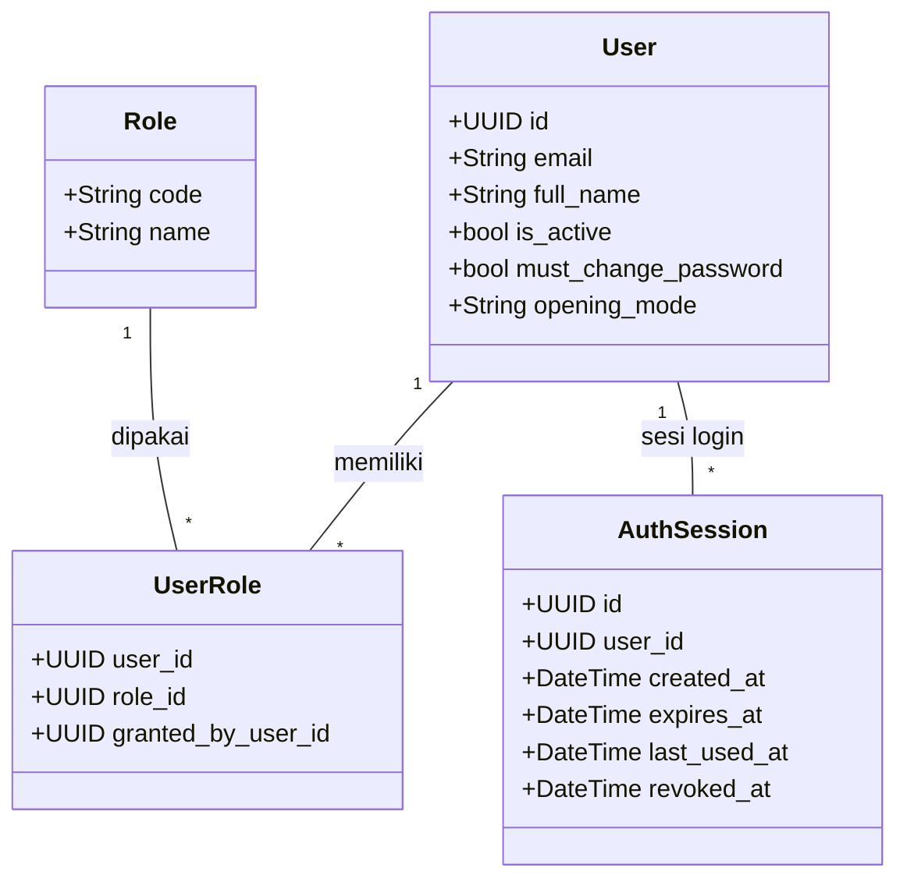
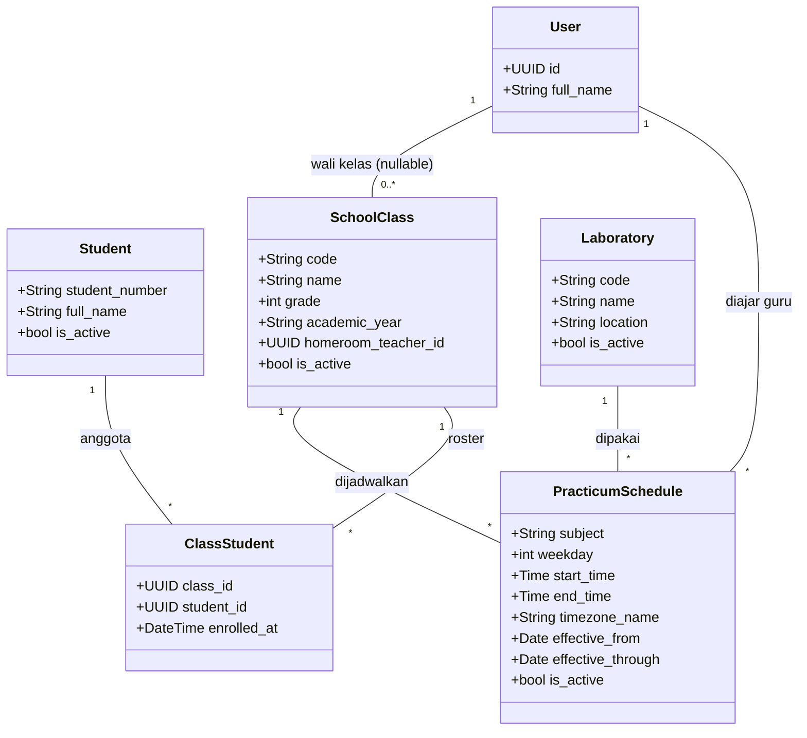
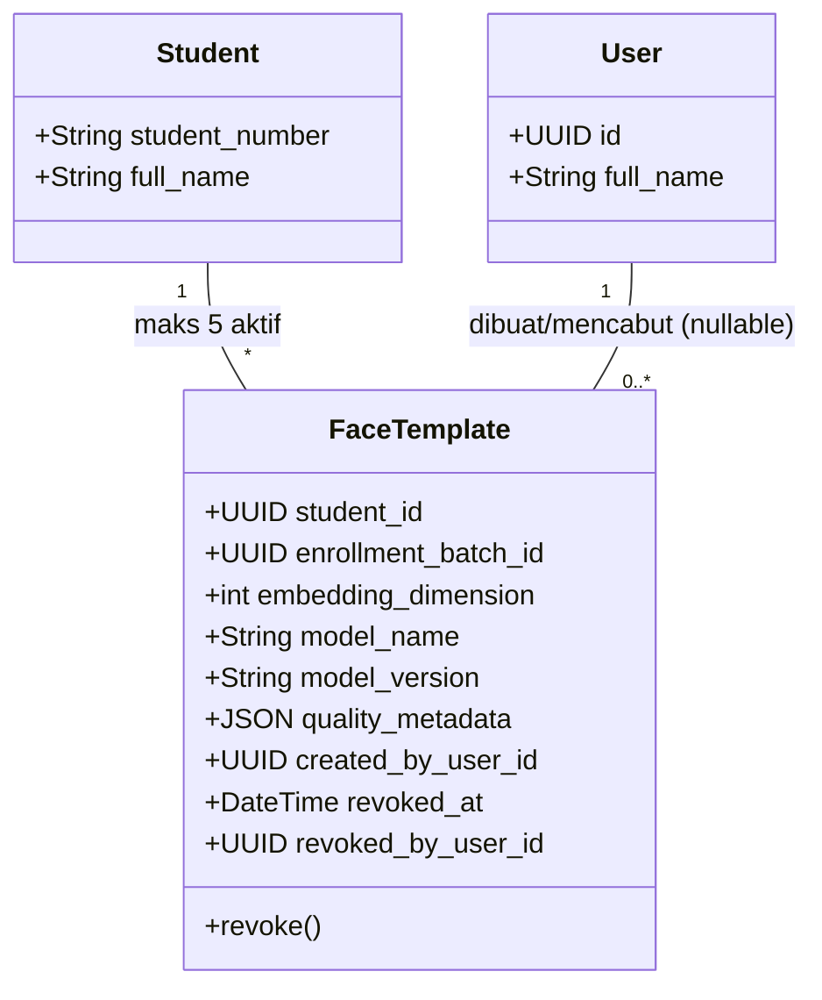
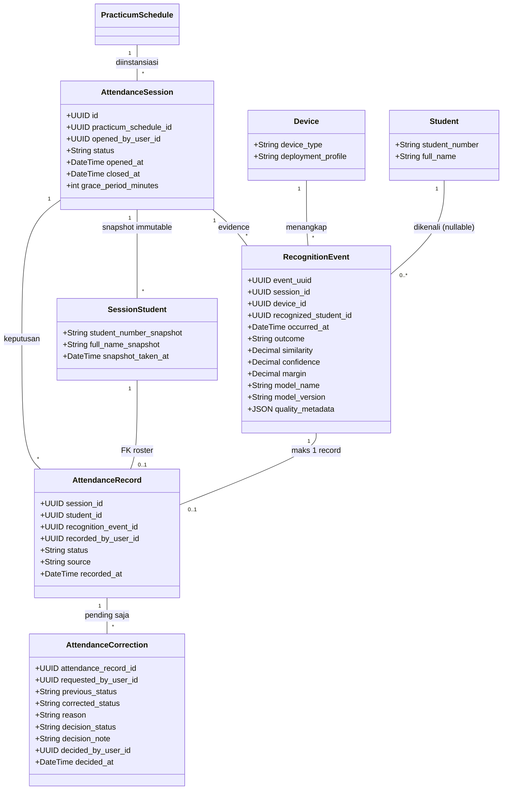
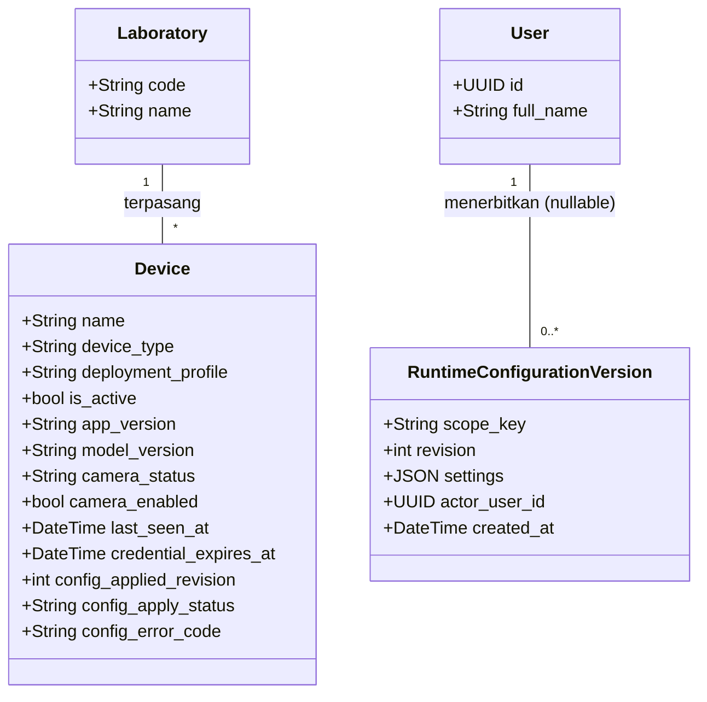
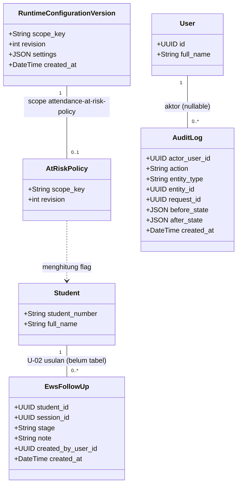

# 07 — Data dan Class Diagram

> Class diagram di bawah digambar **per fitur**. Nama atribut disalin dari
> `apps/api/src/presensi_api/db/models.py` dan diverifikasi terhadap
> `docs/proposal/schema-erd.sql`. Nilai sensitif (password hash, credential
> hash, embedding terenkripsi, token) tersimpan sebagai hash/enkripsi dan
> **tidak dipajang** sebagai data operasional; raw image tidak disimpan.
> Kelas di luar fokus fitur diulang minimal agar tiap gambar mandiri;
> definisi penuh lihat diagram fiturnya. `created_at`/`updated_at` teknis
> dihilangkan kecuali relevan secara domain (expiry, revoke, record, audit).
> ERD lengkap: render
> [schema-erd.sql](schema-erd.sql) (18 tabel, tanpa data).

## 7.1 Akun dan otorisasi (F-01, F-13)

`opening_mode` ∈ {manual, automatic} via CHECK (konsisten 03/F-05:
worker auto-open vs guru manual). `granted_by_user_id` nullable
(pemberi role boleh sistem).

## 7.2 Master siswa, kelas, lab (F-02, F-04)

`homeroom_teacher_id` nullable → `users` (eskalasi wali kelas U-04,
konsisten 03); `location` dan `effective_through` nullable.

## 7.3 Enrollment wajah (F-03)

Embedding tersimpan **terenkripsi (AES-256-GCM)** beserta `model
name/version` wajib; tanpa raw image; kolom hash/sandi tidak dipajang.
Batas 5 template aktif per siswa ditegakkan di API (`MAX_STORED_TEMPLATES
= 5`, `enrollment_templates.py`).

## 7.4 Sesi dan keputusan presensi (F-05, F-06, F-07)

`opened_by_user_id` **nullable** — worker auto-open berjalan tanpa guru
(konsisten 03/F-05, 06/state auto-open). `status` ∈ {active,
manual_override, closed, cancelled} (konsisten 05/06).
`recognized_student_id` nullable (wajib hanya bila `outcome = matched`);
`recognition_event_id` wajib bila `source = face_recognition`, NULL bila
`manual`/`system`; `recorded_by_user_id` nullable.

## 7.5 Perangkat dan konfigurasi (F-11, F-12)

`device_type` ∈ {edge_pc, camera_gateway} terikat ke
`deployment_profile` ∈ {AI_EDGE, STB_GATEWAY} via CHECK. Kredensial
device tersimpan sebagai hash dan tidak dipajang; yang ditampilkan hanya
`credential_expires_at` operasional. `config_error_code` nullable dan hanya
terisi bila apply config gagal.

## 7.6 Laporan dan EWS (F-09, F-10, U-02)

- `AtRiskPolicy` **bukan tabel mandiri** — view atas
  `runtime_configuration_versions` scope `attendance-at-risk-policy`
  (terverifikasi `AT_RISK_POLICY_SCOPE` di `runtime_configuration.py`);
  ambang (`window_days`, `absence_pct_threshold`,
  `late_count_threshold`) tersimpan di `settings` JSONB + `revision`
  beraudit (konsisten 09: default 30 hari + 20 persen + 3x bila policy
  belum tersimpan).
- `EwsFollowUp` (U-02, tabel usulan `ews_follow_ups`) **belum ada di
  database berjalan** — DDL masih komentar di `schema-erd.sql`, perlu
  migrasi Alembic bila diimplementasikan (konsisten 03/U-02, 09).
- `actor_user_id` nullable (aksi sistem OK); `request_id`,
  `before_state`/`after_state` nullable.

## 7.7 Ringkasan 18 tabel (untuk Bab "Perancangan Basis Data")

| Tabel | Peran |
|---|---|
| users, roles, user_roles, auth_sessions | Akun, role, sesi login |
| students, classes, class_students | Master + roster kelas |
| laboratories, devices | Lab + registry perangkat |
| runtime_configuration_versions | Policy berversi (AI config, ambang EWS) + penerbit |
| practicum_schedules | Jadwal mingguan |
| attendance_sessions, session_students | Sesi + snapshot roster immutable |
| face_templates | Embedding terenkripsi + model name/version |
| recognition_events | Bukti audit (matched/ambiguous/no_match/error/redacted) |
| attendance_records | Keputusan final (present/late/absent/excused) |
| attendance_corrections | Pengajuan koreksi pending |
| audit_logs | Jejak aksi |

Aturan keras: `attendance_records(session_id, student_id)` unik; record
face_recognition wajib menunjuk event; record manual/system tidak boleh
menunjuk event; satu event maksimal satu record; FK record →
`session_students` menjamin siswa di snapshot. DDL usulan EWS
(`ews_follow_ups`) tetap proposal di luar 18 tabel.
