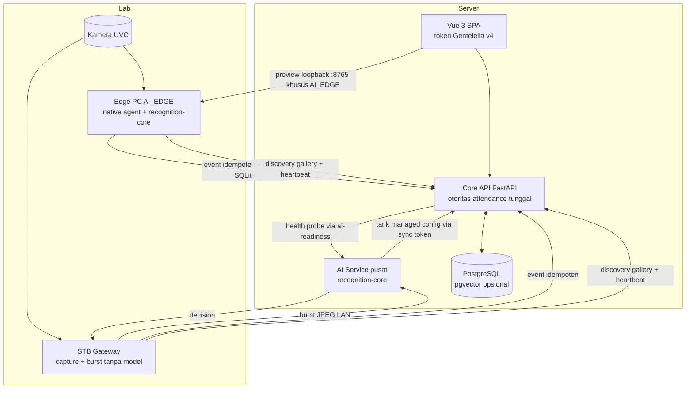
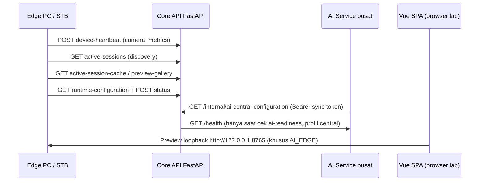

# 08 — Arsitektur Detail

Sumber: `docs/architecture/*`, `docs/adr/*`, `libs/recognition-core`,
`apps/edge-agent`, `apps/ai-service`, `apps/api`.

Stack terverifikasi: Vue 3 + Vite + TypeScript, FastAPI, PostgreSQL
(+ pgvector opsional untuk embedding), Python + OpenCV + ONNX Runtime
melalui `libs/recognition-core`. Panah pada diagram di bawah menunjukkan
arah request yang terverifikasi dari kode (siapa memanggil siapa),
bukan arah aliran data semata.

## 8.1 Container (render → "Arsitektur Sistem")

Arah tarik (pull, bukan push): edge (PC dan STB) yang memanggil Core API
untuk discovery gallery, heartbeat, dan runtime-configuration; AI service
yang memanggil Core API untuk sync managed config; Core API hanya aktif
memanggil AI service pada health probe `GET /health` saat profil central.

## 8.2 Dua profil, satu core (ADR-001)

| Aspek | AI_EDGE (default) | AI_CENTRAL (opsional) |
|---|---|---|
| Inference | PC lab (YuNet + SFace lokal) | AI service pusat |
| STB | — | Capture + motion/quality gate + burst ≤5 frame JPEG (default 3, interval 0,2 dtk, kualitas 75), tanpa model |
| Gallery | Cache lokal; discovery via `GET active-sessions` + `GET active-session-cache` (bearer device), heartbeat `POST device-heartbeat` | Gallery per sesi di AI service (`CoreApiGalleryProvider` menarik `active-session-cache` + validasi `active-sessions`/`device-status` memakai device token), TTL 300 dtk |
| Kirim hasil | Event langsung + outbox SQLite (FIFO, allowlist 13 field, tanpa image/embedding) | STB teruskan decision sebagai event |
| Konfig & readiness | Edge MENARIK `GET runtime-configuration` + lapor status; Core tidak push | AI service MENARIK `GET /api/v1/internal/ai-central-configuration` (Bearer sync token, tiap 15 dtk, tolak rollback revisi); Core API probe `GET /health` AI service via `GET /admin/system/ai-readiness` (profil central saja) lapor enrollment-ready, central ready/degraded/unreachable, thresholds_configured, revisi sync |
| Preview pra-sesi | Loopback browser → PC `:8765` (bind loopback-only, token operator 300 dtk); tanpa sesi aktif; jendela mulai−15 mnt; kandidat tanpa event (lihat 8.7) | Tanpa preview loopback; observasi via dashboard + `ai-readiness` |
| Fail-closed | Model/threshold hilang → `ValueError`, nonaktif | Runner belum siap → 503; token hilang → `auth_misconfigured` |

Keduanya override `pipeline.max_candidates = max(2, len(gallery))` sehingga
margin Top-1/Top-2 selalu dihitung di atas galeri penuh; re-query internal
pipeline menjadi pengaman kedua.

## 8.3 Pipeline recognition-core (urutan stage + waktu per stage)

`temporal_sampling → preprocess → detect → quality → align → liveness →
embed → match → temporal_decision`. Setiap stage diukur waktunya
(`timing_observer`; header `X-Recognition-Stage-Timings-Ms` bila benchmark on).

| Stage | Model/aturan terverifikasi |
|---|---|
| detect | YuNet (`opencv-zoo-yunet`); ≠1 wajah → `no_face`/`multiple_faces`, tanpa embed/match |
| quality | `min_face_pixels` 80, laplacian ≥45, brightness 25–235; gagal → reset evidence + retry |
| align + embed | SFace (`opencv-zoo-sface`); model name/version wajib cocok, beda → `ValueError` |
| match | Cosine; matcher TANPA threshold default (fail-closed); tie-break by student_id |
| liveness | Opsional; AntiSpoof MN3 (ONNX). Bila required dan gagal → tidak ada embed sama sekali; custom engine yang accept saat PAD gagal dipaksa `retry_frontal`/`rejected` |
| temporal | `minimum_agreeing_frames` 3, `best_frame_count` 5, `max_history_frames` 10; Top-1 ganti → evidence dibuang; gallery 1 identitas → `single_identity_gallery` (retry, bukan accept) |

Default AI Central (terverifikasi `config.py`): sample tiap 1 frame, agreeing 3,
best 5, history 10, burst ≤5, frame ≤3 MiB, request ≤20 MiB, timeout 5 dtk,
rate 10/dtk (burst 20), gallery TTL 300 dtk, token device ≥32 char ASCII.
Threshold Top-1/margin default KOSONG = service degraded, bukan angka tebak.

## 8.4 Keamanan data wajah

1. Raw image transient di memori; tidak ada kolom image/embedding di outbox,
   log, queue, respons (allowlist outbox 13 field skalar).
2. Embedding AES-256-GCM (`embedding_ciphertext` + `encryption_key_id`);
   revoke = soft-delete + ciphertext tidak lagi dibutuhkan. Rotasi kunci via
   CLI `biometric_key_rotation` (re-enkripsi batch 100 ke kunci aktif).
3. Template menyimpan `model_name` + `model_version`; galeri menolak versi beda.
4. Batas API: device 120/mnt, enrollment 10/mnt, body 16 MiB, CORS ketat.
5. Tanpa data wajah siswa nyata/minor di repo/cloud/CI; fixture = sintetis /
   publik legal / relawan dewasa bersedia.
6. Retensi: event lama default 90 hari batch 500 — event bertaut record
   di-redacted (bukan dihapus), event tanpa record dihapus; audit tanpa detail event.

## 8.5 Keputusan arsitektur (ringkas)

- **ADR-001**: satu `recognition-core` untuk edge + central (reuse, bukan fork).
- **ADR-002**: mode pembukaan sesi + preview pra-sesi aman (tanpa event).
- **ADR-003**: `opening_mode` per guru + `manual_override` + auto-close selalu
  — status implementasi **Selesai** (migrasi `f4e5d6c7b8a9`).

## 8.6 Batas hardware (`MANUAL HARDWARE TEST REQUIRED`)

Belum boleh diklaim sebelum uji hardware target: nilai threshold terkalibrasi,
latency p50/p95 per profil, throughput, walk-through vs frontal di 2 ruang
paralel, dan perbandingan AI_EDGE vs AI_CENTRAL (harness `tests/ai-benchmark`,
protokol `docs/pengujian.md`, deployment-benchmark).

## 8.7 Arah tarik, probe, preview, dan event-vs-record (verifikasi kode)

1. `recognition_events` adalah bukti audit yang SELALU disimpan
   (`decide_recognition_event`: event ditulis dulu, lalu validasi).
   `attendance_records` HANYA lahir bila 5 syarat lolos (device aktif dan
   lab sama, sesi aktif, kandidat di snapshot roster, outcome matched +
   liveness lolos, belum ada record student+sesi); duplikat dan replay
   idempoten tidak membuat record baru.
2. Preview pra-sesi khusus AI_EDGE: browser hanya dari `localhost`/
   `127.0.0.1` ke `http://<host>:8765` (agent bind loopback-only);
   operator `ADMIN`/`LABORANT` via `POST /v1/session`, token preview
   300 detik untuk `GET /v1/status` + `GET /v1/frame.jpg`.
3. Gallery preview (`GET preview-gallery`) hanya untuk profil AI_EDGE
   (409 bila profil lain), ditolak 409 bila ada sesi aktif, dan dibatasi
   jadwal lab hari ini: `mulai−15 menit ≤ sekarang < selesai`; 404 bila
   tidak ada kelas terjadwal. Kandidat diagnostik bersifat transient
   (kedaluwarsa ±3 detik), tidak mengirim event, tidak membuat record.
   Event presensi hanya dikirim saat sesi aktif dan track `accepted`.
4. Threshold identitas (`min_top1_similarity`, `min_top1_top2_margin`)
   wajib kalibrasi lokal; kosong = service degraded, bukan angka tebak.
   Nilai hardware-only pada dokumen ini bertanda
   `MANUAL HARDWARE TEST REQUIRED`.
