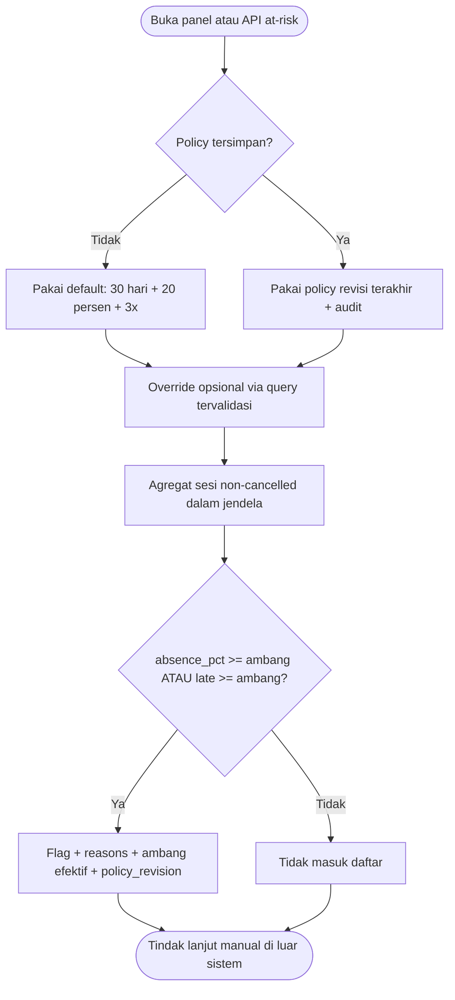
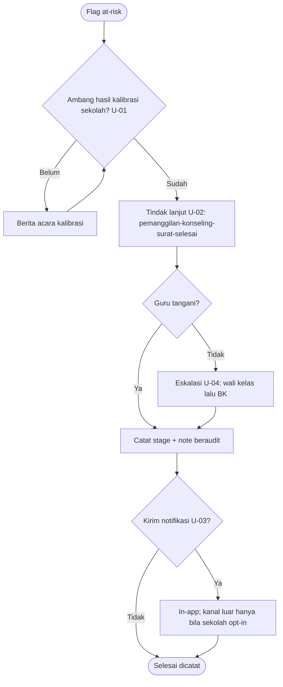

# 09 — Early Warning System (EWS)

## 9.1 Status: tahap 1 SUDAH berjalan (F-10)

Watchlist "Siswa perlu perhatian" — human watchlist, **bukan sanksi, tanpa
notifikasi**. Bukti: `GET /reports/attendance/at-risk[/policy]`, panel
`DashboardView` (`data-testid="at-risk-panel"`), 21 pytest + 8 vitest.



Aturan agregat (terverifikasi `reports.py`): `cancelled` dikecualikan; sesi
closed tanpa record = absen (pakai `closed_at`/`recorded_at`/`opened_at`
berurutan); sesi open tanpa record = `not_recorded`, tidak dihitung absen;
`excused` bukan absen; guru hanya melihat jadwal miliknya; urut
absence_pct desc → late desc → nama; paginasi in-memory; respons selalu
menggemakan ambang efektif + revisi agar flag bisa dijelaskan.

## 9.2 Usulan tahap 2 (U-01–U-04) — tanpa ubah arsitektur



Data baru (satu-satunya perubahan skema; via migrasi Alembic):

```sql
CREATE TABLE ews_follow_ups (
  id             UUID PRIMARY KEY DEFAULT gen_random_uuid(),
  student_id     UUID NOT NULL REFERENCES students(id) ON DELETE RESTRICT,
  session_id     UUID REFERENCES attendance_sessions(id) ON DELETE SET NULL,
  stage          VARCHAR(32) NOT NULL,  -- pemanggilan|konseling|surat|selesai
  note           TEXT NOT NULL,
  created_by_user_id UUID REFERENCES users(id) ON DELETE SET NULL,
  created_at     TIMESTAMPTZ NOT NULL DEFAULT now()
);
```

Bukan tujuan: sanksi otomatis, blokir presensi, notifikasi eksternal default,
skor risiko yang tidak bisa dijelaskan.
