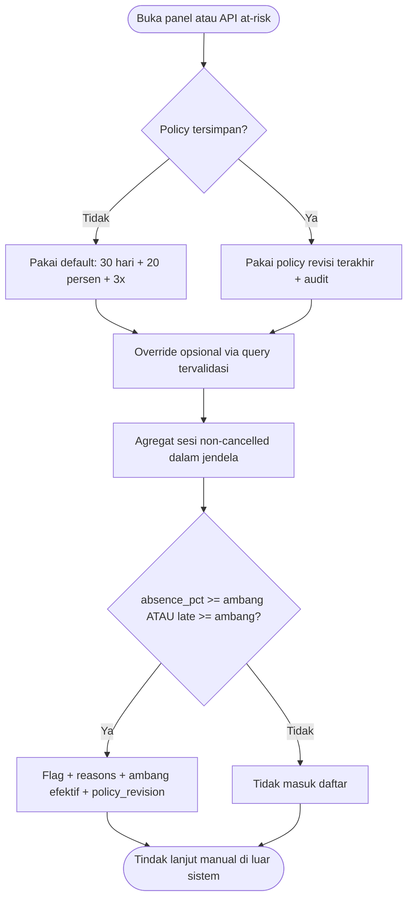
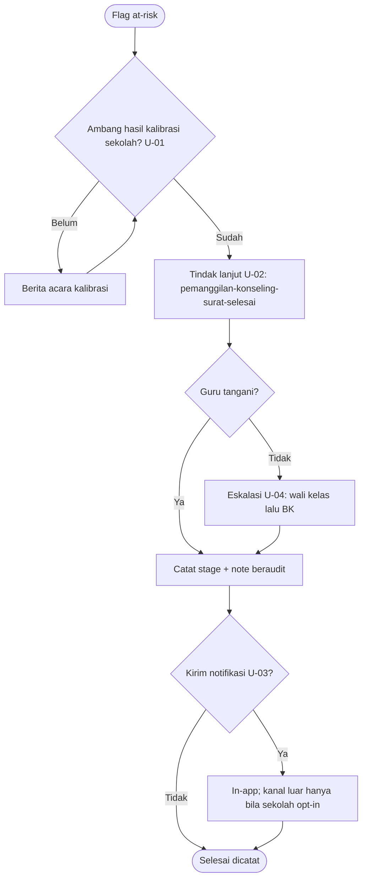

# 09 — Early Warning System (EWS)

## 9.1 Status: tahap 1 SUDAH berjalan (F-10)

Watchlist "Siswa perlu perhatian" — human watchlist, **bukan sanksi, tanpa
notifikasi**. Bukti: `GET /reports/attendance/at-risk[/policy]`, panel
`DashboardView` (`data-testid="at-risk-panel"`), endpoint tindak lanjut
`GET/POST /reports/attendance/at-risk/{student_id}/follow-ups` (+ `PATCH
…/follow-ups/{follow_up_id}`), drawer EWS di `EwsView`. Tindak lanjut
(U-02) SUDAH menjadi bagian F-10 berjalan (bukan usulan).



Aturan agregat (terverifikasi `reports.py`): `cancelled` dikecualikan; sesi
closed tanpa record = absen (pakai `closed_at`/`recorded_at`/`opened_at`
berurutan); sesi open tanpa record = `not_recorded`, tidak dihitung absen;
`excused` bukan absen; guru hanya melihat jadwal miliknya; urut
absence_pct desc → late desc → nama; paginasi in-memory; respons selalu
menggemakan ambang efektif + revisi agar flag bisa dijelaskan.

## 9.2 Usulan tahap 2 (U-01, U-03–U-04) — tanpa ubah arsitektur

> U-02 (riwayat tindak lanjut) SUDAH jalan sebagai F-10 — tersisa U-01
> (berita acara kalibrasi ambang), U-03 (notifikasi in-app), U-04 (eskalasi).



Skema berjalan (`ews_follow_ups`, via migrasi Alembic; DDL penuh di
`schema-erd.sql`):

```sql
CREATE TABLE ews_follow_ups (
  id             UUID PRIMARY KEY DEFAULT gen_random_uuid(),
  student_id     UUID NOT NULL REFERENCES students(id) ON DELETE CASCADE,
  author_user_id UUID NOT NULL REFERENCES users(id) ON DELETE RESTRICT,
  status         VARCHAR(16) NOT NULL DEFAULT 'open' CHECK (status IN ('open','done')),
  resolved_at    TIMESTAMPTZ,
  note           TEXT NOT NULL,
  created_at     TIMESTAMPTZ NOT NULL DEFAULT now(),
  updated_at     TIMESTAMPTZ NOT NULL DEFAULT now()
);
```

Bukan tujuan: sanksi otomatis, blokir presensi, notifikasi eksternal default,
skor risiko yang tidak bisa dijelaskan.
